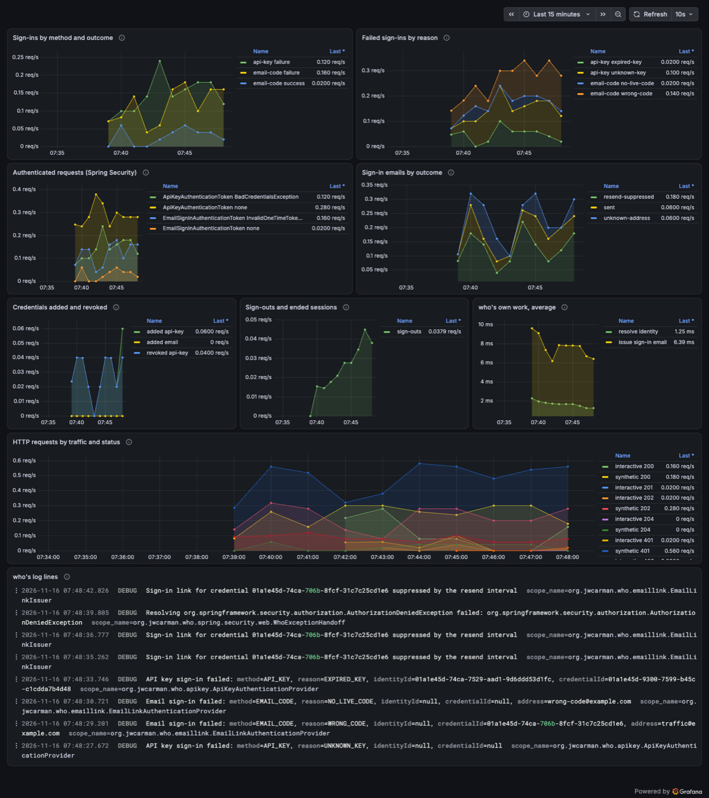

# Example: observability

who counts sign-ins, failures and sign-in emails as Micrometer meters, times its own work as
observations, and logs why each sign-in failed. This example shows all three in Grafana's LGTM
stack (Loki for logs, Tempo for traces, Prometheus for metrics), with a provisioned "who" dashboard,
a traffic generator that keeps it moving, and a page where you make each request yourself and
follow it to its trace and log lines.



who needs no observability configuration of its own. The app adds Spring Boot's Actuator and
OpenTelemetry starters, and who's meters, spans and logs go wherever Spring Boot sends them.

The app is small: email codes for signing in, API keys for a one-endpoint API, on who's default
chain. There is no JWT sign-in here, since it needs an authorization server; JWT sign-ins appear
on the same meters, with `method="jwt"`.

## Run it

You need Java 25 and Docker. From the repository root:

```bash
./mvnw install -DskipTests
./mvnw spring-boot:run -pl who-examples/observability
```

Spring Boot's Docker Compose support starts Postgres, Mailpit and `grafana/otel-lgtm` from
`compose.yaml`, and connects the app's OTLP metrics, traces and logs to it. The examples use the
same ports: run one at a time.

- The page: <http://localhost:8080>
- The dashboard: <http://localhost:3000/d/who>
- Mailpit, where the sign-in emails land: <http://localhost:8025>

Within a minute every panel on the dashboard has data from the traffic generator.

## Try it yourself

On the page, each button makes one request:

1. **Email me a code**, then copy the code from Mailpit and **Sign in with the code**.
2. **Make a key**, then **Read with the key** (200) and **Write with the key** (403: the key may
   only read).
3. **Call with an unknown key**, **Revoke the key**, then **Read with the key** again (401).
4. **Email a code to an unknown address**: the same answer as for a known one, so nobody can probe
   for accounts. Only the meter tells them apart.
5. **Sign in with a wrong code**, and **Sign out**.

Under each answer is its trace id, from the app's `X-Trace-Id` header, with two links:

- **open the trace**: the request in Tempo. Spring Security's spans are inside it, and who's
  `who resolve principal` span inside those.
- **its log lines**: the request's lines in Loki. A failed sign-in has who's DEBUG line saying
  why, for example `reason=WRONG_CODE`.

Your requests are tagged `traffic="interactive"` on `http_server_requests`, the generator's
`traffic="synthetic"`, so the HTTP panel can show them apart.

## The dashboard

`grafana/who-dashboard.json`, provisioned into the LGTM image's Grafana by `compose.yaml`:

| Panel | Reads |
|---|---|
| Sign-ins by method and outcome | `who_sign_ins_total` |
| Failed sign-ins by reason | `who_sign_ins_total{outcome="failure"}` |
| Authenticated requests | `spring_security_authentications_milliseconds_count` |
| Sign-in emails by outcome | `who_sign_in_emails_total` |
| Credentials added and revoked | `who_credentials_added_total`, `who_credentials_revoked_total` |
| Sign-outs and ended sessions | `who_sign_outs_total`, `who_sessions_ended_total` |
| who's own work, average | `who_principal_resolve_*`, `who_sign_in_email_issue_*` |
| HTTP requests by traffic and status | `http_server_requests_milliseconds_count` |
| who's log lines | Loki, who's loggers (`org.jwcarman.who.*`, not the example's) |

Things worth knowing when you read it:

- `who.sign-ins` counts API-key and JWT *failures* only. A key signs in every request, so
  successes would just count requests; Spring Security's `spring.security.authentications`
  counts every one of them instead.
- A revoked key is unknown to who, so it fails as `unknown-key`, like a key who never issued.
- who's tags hold only who's own values (`method`, `outcome`, `reason`, `kind`): no address,
  identity id or credential id. That is also why the `traffic` tag is on Spring's HTTP meter
  and not on who's: who's meters cannot be split by request.
- Requests that Spring Security answers itself (sign-ins, code requests, 401s) have
  `uri="UNKNOWN"` on `http_server_requests`, since no controller handled them.
- Micrometer sends latency histograms only when asked, so the "who's own work" panel shows
  averages. Set `management.metrics.distribution.percentiles-histogram` for percentiles.

## The traffic generator

Every 1.5 seconds `TrafficGenerator` picks a scenario by weight and makes real HTTP requests to
the app, with the header `X-Traffic: synthetic`: good, unknown, revoked and expired keys, a key
without the scope, code requests for known and unknown addresses, wrong codes, and whole email
sign-ins, reading the code back from Mailpit's API and signing out after. It signs in as
`traffic@example.com` and `wrong-code@example.com`, so the demo person's codes are left alone.

Turn it off with `example.traffic.enabled=false`; `example.traffic.interval` sets the pace.

## What the app configures

- `spring-boot-starter-actuator` and `spring-boot-starter-opentelemetry`: meters, traces and the
  OTLP exporters.
- `opentelemetry-logback-appender-1.0`, `logback-spring.xml` and `OpenTelemetryLogs`: Logback
  hands log events, with their trace ids, to OpenTelemetry, as Spring Boot's documentation shows.
- `application.yml`: every request traced, metrics pushed every 10 seconds, and who's logging at
  DEBUG.
- `TraceIdFilter`: the `X-Trace-Id` header, for the page. `TrafficObservations`: the `traffic`
  tag.

## In production

- **Sample.** `management.tracing.sampling.probability: 1.0` traces every request; pick a rate.
- **Keep who's logging at INFO.** The DEBUG line for a failed email sign-in includes the address
  that was tried. Turning DEBUG on here puts addresses in Loki; in production, do it only while
  investigating, and only where those logs may hold personal data.
- **Protect Grafana and the collector.** The LGTM image is for development: anonymous admin, no
  retention policy, and an open OTLP port.
- **Alert on the meters.** The Observability guide has example alerts: codes being guessed,
  emails not going out, keys being tried.
